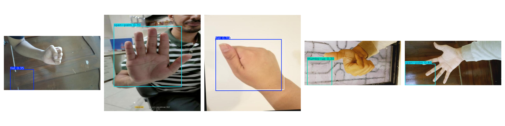
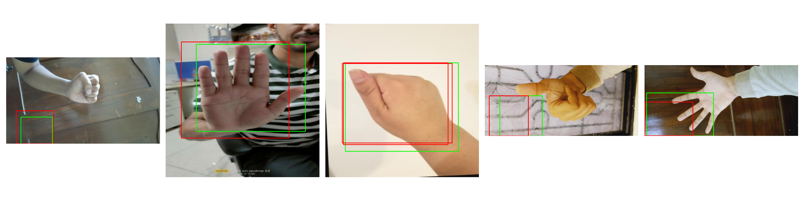

# AirDraw AI — Hand Gesture Detection with YOLOv8

**CSCI1409 Deep Learning | Bonus Project | KBTU**

AirDraw AI is a hand gesture detection project using YOLOv8n. The model recognizes four hand gestures and can be used in a virtual drawing application with MediaPipe and OpenCV.

The main goal of this project is to train an object detector, compare two learning rates, and evaluate the best model on unseen test images.

## 1. Dataset

**Dataset:** Hand Gesture Detection Base  
**Source:** [Roboflow](https://universe.roboflow.com/akerke-zhumabekova/hand-gesture-detection-base-hehmh)  
**Version:** 1  
**Annotation format:** YOLO bounding boxes

The dataset contains **1,660 images** and four classes:

- `fist`
- `open-palm`
- `point`
- `thumbs-up`

### Dataset Split

| Split | Images |
|---|---:|
| Training | 1,162 |
| Validation | 332 |
| Testing | 166 |
| **Total** | **1,660** |

The dataset contains both annotated hand gestures and background images.

We checked the dataset for missing labels, invalid bounding boxes, and exact duplicates between the splits. No exact duplicate images were found across the splits.

Some annotations appear inaccurate or shifted, which may affect detection performance.

**Dataset usage terms:** Refer to the license and usage conditions published on the Roboflow dataset page.

## 2. Model and Training

We used the pretrained **YOLOv8n** object detection model from Ultralytics.

YOLOv8n was selected because it is lightweight and suitable for training with limited computing resources.

### Training Configuration

| Parameter | Value |
|---|---|
| Framework | Ultralytics 8.4.215 |
| Initial weights | `yolov8n.pt` |
| Image size | 640 × 640 |
| Batch size | 16 |
| Optimizer | AdamW |
| Momentum | 0.9 |
| Epochs | 20 |
| Random seed | 42 |
| Device | NVIDIA Tesla T4 (Google Colab) |
| Number of classes | 4 |

Both models were trained using the same dataset and pretrained weights.

## 3. Controlled Experiment

We performed two experiments to investigate the effect of learning rate on YOLOv8n performance.

**Hypothesis:** Reducing the learning rate may improve detection performance by allowing more gradual weight updates.

- **Experiment 1 — Baseline:** Learning rate = 0.00125
- **Experiment 2 — Lower LR:** Learning rate = 0.000625

Only the learning rate was intentionally changed. All other training settings remained the same.

### Validation Results

| Metric | Baseline | Lower LR |
|---|---:|---:|
| Precision | 78.93% | **80.15%** |
| Recall | 67.59% | **69.40%** |
| mAP@0.50 | 75.84% | **76.38%** |
| mAP@0.50:0.95 | 52.55% | **53.58%** |

The lower learning rate achieved slightly better results on the validation dataset.

The improvement in mAP@0.50 was approximately 0.54 percentage points.

However, this is a small improvement and does not prove that lower learning rates always perform better.

### Final Model Selection

We selected **Experiment 2 (Lower LR)** because it achieved higher validation mAP scores.

The best checkpoint was saved as:

`models/best.pt`

The test dataset was not used to select the final model.

## 4. Final Test Results

The selected model was evaluated on the held-out test dataset.

**Test dataset:** 166 images and 156 annotated objects.

| Metric | Result |
|---|---:|
| Precision | **86.26%** |
| Recall | **69.81%** |
| mAP@0.50 | **79.91%** |
| mAP@0.50:0.95 | **58.90%** |

### Evaluation Settings

| Parameter | Value |
|---|---|
| Dataset split | Test |
| Image size | 640 |
| Confidence threshold | 0.001 |
| NMS IoU threshold | 0.7 |
| Device | NVIDIA Tesla T4 |

### Metric Explanation

- **Precision:** Measures how many predicted detections are correct.
- **Recall:** Measures how many actual objects were successfully detected.
- **mAP@0.50:** Measures average detection precision across all classes at an IoU threshold of 0.50.
- **mAP@0.50:0.95:** Measures average precision across multiple IoU thresholds from 0.50 to 0.95.

The `point` gesture achieved the best detection performance, while `thumbs-up` remained the most challenging class.

## 5. Prediction Examples

The following image shows predictions on five test images, including bounding boxes, predicted gesture classes, and confidence scores.



## 6. Failure Analysis

We compared predicted bounding boxes with ground-truth annotations.

Green boxes represent the ground truth, while red boxes represent YOLO predictions.



### Failure 1 — Incorrect Fist Localization

The predicted bounding box was positioned below the actual fist. The ground-truth annotation was also shifted away from the hand.

### Failure 2 — Incorrect Thumbs-Up Localization

The predicted bounding box covered part of the background instead of accurately surrounding the hand.

### Failure 3 — Inaccurate Open-Palm Bounding Box

The model recognized the open-palm gesture but did not accurately cover the entire hand with its bounding box.

### Possible Causes

- Inaccurate ground-truth annotations
- Different hand positions and orientations
- Background variations
- Limited examples of certain gestures

### Suggested Improvement

A practical improvement would be to review and correct inaccurate annotations before retraining the model.

## 7. Google Colab

The project includes a Google Colab notebook that demonstrates the complete object detection workflow.

**[Open in Google Colab](https://colab.research.google.com/github/unnamedwho/AirDrawAI/blob/main/AirDraw_colab.ipynb)**

The notebook includes:

1. Installing dependencies
2. Downloading the dataset from Roboflow
3. Checking dataset information
4. Training the baseline model
5. Training a second model with a lower learning rate
6. Comparing validation results
7. Evaluating the selected model on the test set
8. Visualizing predictions and analyzing errors

### Running the Colab Notebook

1. Open the notebook using the link above.
2. Select **Runtime → Change runtime type → T4 GPU**.
3. Add your own Roboflow API key in **Colab Secrets** under `ROBOFLOW_API_KEY`.
4. Enable notebook access to the secret.
5. Run the notebook cells in order.

The dataset is downloaded automatically, so local dataset files are not required.

## 8. Local Setup

Clone the repository:

```bash
git clone https://github.com/unnamedwho/AirDrawAI.git
cd AirDrawAI
```

Create a Python virtual environment:

```bash
python3 -m venv .venv
source .venv/bin/activate
```

Install dependencies:

```bash
pip install -r requirements.txt
```

To run the gesture detection and virtual drawing application:

```bash
python airdraw.py
```

The application uses:

- **YOLOv8n** to recognize hand gestures
- **MediaPipe** to track the index fingertip
- **OpenCV** to display the camera and drawing canvas

### Gesture Controls

| Gesture | Action |
|---|---|
| Point | Draw |
| Fist | Stop drawing |
| Open Palm | Clear canvas |
| Thumbs Up | Save drawing |

Press **Q** to close the application.

A working webcam and camera permissions are required.

## 9. Model Weights

The final trained model is stored at:

`models/best.pt`

This checkpoint comes from the lower-learning-rate experiment trained in Google Colab.

It can be loaded using:

```python
from ultralytics import YOLO

model = YOLO("models/best.pt")
```

The model was trained to detect four hand gesture classes.

## 10. Limitations

Although the model achieved promising test results, several limitations remain:

- Some dataset annotations contain inaccurate bounding boxes.
- The thumbs-up gesture is more difficult to recognize.
- The test dataset contains only 166 images.
- Performance on real-time webcam images may differ from test performance.
- The drawing application depends on stable hand tracking and gesture recognition.

Future improvements could include better annotations, more diverse training images, and improved gesture stabilization for real-time drawing.

## 11. Tools and Acknowledgments

- [Ultralytics YOLOv8](https://github.com/ultralytics/ultralytics)
- [Roboflow](https://roboflow.com/)
- [Google Colab](https://colab.research.google.com/)
- [MediaPipe](https://developers.google.com/mediapipe)
- [OpenCV](https://opencv.org/)

AI assistance was used for coding support, debugging, and documentation. Model training, evaluation, and experiment testing were performed as part of the university project.

## 12. Conclusion

This project successfully fine-tuned YOLOv8n to detect four hand gestures.

Two learning rates were compared under controlled training settings.

The lower-learning-rate model achieved slightly better validation performance and was selected for final testing.

The selected model achieved **79.91% mAP@0.50** on the held-out test dataset.

The trained detector can also be integrated with MediaPipe and OpenCV to create a gesture-controlled virtual drawing application.
